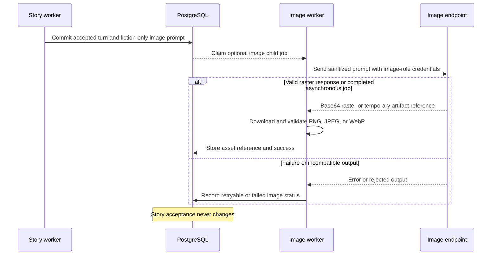

# Illustration pipeline

Illustrations use an independent provider boundary. The implementation supports both accepted-turn jobs and provisional segmented jobs while narration is streaming. Image failure does not determine whether a story turn is accepted.

## Accepted-turn path

The following diagram describes jobs created from an accepted turn.

The image role has its own endpoint, key, model inventory, defaults, health, attempts, and campaign settings. It does not inherit the story text profile.

World-cover generation uses the same durable worker path with a different target: an editable world rather than an accepted turn. It always resolves the default image provider and model, stores the completed asset on the world, and never creates a campaign or changes campaign cost totals.

The required boundary is fiction-only input: rolls, private reasoning, hidden trackers, raw responses, and text-provider credentials must not enter the image prompt. The provisional path below begins before final-turn validation, so segment sanitization must not be described as proof of accepted narration.

Generated files are content-addressed and independently retryable. Sogni remote job IDs, generation revisions, deadlines, and polling state are durable so another worker can resume safely without intentionally duplicating an accepted remote workflow. Provider artifacts are downloaded under bounded network and size controls, then validated by raster signature as PNG, JPEG, or WebP; SVG and payloads masquerading as images are rejected.

## Provisional streaming path and open contract conflict

When streaming segmentation is active, the Story worker extracts partial narration, strips mechanics from the image-prompt excerpt, and creates a provisional illustration set and segments scoped to the generation job. Direct mode queues an image job immediately; AI-refined mode queues prompt refinement. These jobs can run before the final story turn is validated and committed.

On acceptance, promotion compares each streamed segment with the accepted narration. If every segment is a slice of the accepted text, promotion attaches the provisional set, segments, and jobs to the accepted turn. Segments that differ only in whitespace take the accepted offsets. If any segment is not accepted text, for example after a scene-coverage rewrite or a retried attempt, promotion supersedes the whole provisional set. It cancels the set's unfinished image, refinement, and library-matching jobs, and builds a new set from the accepted narration. Rejected narration is therefore never attached to a turn. Images that already finished for the superseded set stay in the asset library only.

A streamed image job that finishes after its turn was accepted still publishes, because promotion has bound it to that turn. Jobs of a cancelled or failed generation are never bound and stay fenced. On terminal generation failure, the worker attempts to orphan the provisional set; cleanup failure does not replace the generation result. This lifecycle cannot undo a provider request already submitted, so a superseded or orphaned set may still have incurred image cost.

[ADR 0025](../architecture/0025-streaming-illustration-pipeline.md) records this implementation. Its pre-commit dispatch conflicts with the repository requirement to dispatch illustrations only after narration and the fiction-only prompt pass validation. That contract remains unresolved: this description records current behavior, does not authorize weakening validation, and does not certify that provisional excerpts will pass final-turn validation.

## Library matching

Library-first campaigns score eligible library assets before requesting a new image (algorithm `library-match-v2`). Both the query prompt and each asset's stored prompt are reduced to scene words: the character reference and art style blocks are removed, and so is wording shared by the campaign's illustration templates. Without that step, every illustration would share most of its words. Same-campaign and same-world provenance only add to a score in proportion to scene overlap, so provenance alone cannot clear a threshold. Generated assets that record no entities use their source turn's Chronicle entities, so a candidate from a scene with different characters is penalized. The database pre-rank matches any shared scene word, so a strong older match is not lost behind the newest hundred assets.

The repetition window counts reuse by turn number. A streamed segment is matched before its turn exists, so it uses the turn number its generation will produce. Earlier segments of the same turn also count as recent uses. Promotion records the accepted turn on streamed matches.

Related decisions: [ADR 0008](../architecture/0008-independent-illustration-pipeline.md) and [ADR 0025](../architecture/0025-streaming-illustration-pipeline.md).
