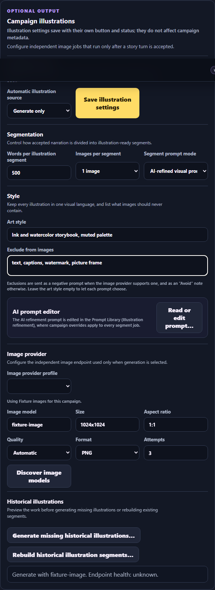
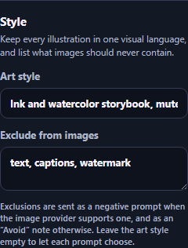

# Campaign illustration accuracy review

Date: 2026-10-13. Branch: `worktree-illustration-accuracy-fixes`.

This review covers per-turn campaign illustrations from segmentation through prompt construction, library reuse, and provider dispatch. It lists each finding, what changed, and one deferred item.

## Findings and changes

### Refinement context was empty for streamed segments

Refinement jobs for streamed segments run before their turn is accepted, so the job has no `turn_id`. The context query joined on that turn, returned no row, and sent an empty `storyContext`. In practice the main per-turn path never gave the refiner the world, genre and tone, character appearance, or previous scene.

The context now resolves the turn position from the generation job when no accepted turn exists yet. It also includes the end of the previous turn instead of its start, the end of the preceding segment in the same turn, and the campaign art style.

### Rejected narration could stay illustrated

Streamed segments are cut from narration before validation. A scene-coverage rewrite or a retried attempt can replace that narration, but promotion only filled in missing ordinals and then stamped the set with the accepted narration's hash. This broke the repository rule that rejected narration never reaches the image endpoint.

Promotion now checks that every streamed segment is a slice of the accepted narration. Whitespace-only differences take the accepted offsets. Any other mismatch supersedes the provisional set, cancels its unfinished image, refinement and matching jobs, and builds a new set from the accepted narration. A cancelled job of a superseded or orphaned set can no longer be retried.

### Streamed images that finished after acceptance were not published

The publication repository allowed a job with a `generation_job_id` to publish only while that generation was active. Once the turn committed, any streamed image still rendering was refused, its lease expired, and the worker claimed it again. Publication now also accepts a job that promotion has bound to the accepted turn. The segment and library-matching adapters already used that rule. Cancelled and failed generations never bind their jobs, so those stay fenced.

### Library reuse ignored the repetition window for streamed segments

Streamed resolution jobs and their `asset_references` were recorded without a turn, and promotion did not update them, so the reuse count never saw them. Promotion now records the turn on both. Matching uses the generation's expected turn number when the turn does not exist yet. Earlier segments of the same turn count as recent uses.

### Library scores were dominated by shared wording

- Assets store the full provider prompt, and in direct mode the query is the full direct-template prompt. Template and character-reference wording made unrelated scenes overlap by around 88%. Scoring now removes the character-reference and art-style blocks and ignores wording from the default and campaign illustration templates.
- Campaign and world provenance added 0.30 regardless of content, enough to cross the `broad` threshold with 15% overlap. Provenance now scales with scene overlap and reaches its full weight at 35% coverage.
- The pre-rank used `websearch_to_tsquery`, which requires every prompt word. Nearly every candidate ranked zero, and the `LIMIT 100` fell back to the newest assets. It now matches any shared scene word.
- Generated assets never record entities, so the entity-mismatch penalty could not fire. Their source turn's Chronicle entities now stand in.

The algorithm version is now `library-match-v2`.

### Prompt construction

- **Exclusions in the positive prompt.** The direct template said "Do not add typography…". Diffusion models tend to draw what a prompt names. Exclusions are now a campaign **Exclude from images** setting, stored per image job. Sogni receives it as a negative prompt. OpenAI-compatible and OpenRouter endpoints, which have no negative-prompt field, receive a closing "Avoid: …" sentence.
- **No campaign art style.** The refiner chose a medium for each segment, so the style drifted. A campaign **Art style** is now added to every composed prompt and given to the refiner as fixed.
- **No prompt length limit.** Direct mode could send thousands of words, and DALL·E 3 rejects prompts over 4,000 characters. Composed prompts are now limited to 3,400 characters. The scene is shortened and the style and character reference are kept.
- **Refinement prompt gaps.** The default now asks for framing and the number of visible figures, positive terms only, under 90 words, and no competing style when an art style is fixed.

Migration `0116_illustration_art_style_negative_prompt` adds the two campaign settings and the per-job negative prompt. Campaign copies, branches, campaign archives, and System Archives carry the new settings. Archives without them import with an empty art style and the default exclusions.

## Deferred: character appearance for recurring cast

Deferred at the user's request until character tracking is redone:

- Only the player character has a visual reference (`characterVisualReference`). Recurring NPCs drift between images. Campaign Cast `appearance.*` observations for characters named in a segment should feed the refiner.
- The appended **CANONICAL CHARACTER REFERENCE** block says "use only if depicted". Image models cannot follow conditional instructions, and scene prompts rarely name the character. The refiner should write appearance into the subject description and report `characters_present`, and the block should be appended only when the character is present.
- The refinement prompt should describe people by appearance rather than name.

## Not changed

These were suggestions in the review, not defects:

- Streamed segments still start paid image work before acceptance. Superseded and orphaned sets may already have incurred cost. A setting to wait for acceptance would trade speed for cost.
- There is still no check of a refined prompt against its source excerpt before image dispatch.

## Verification

| Check | Result |
| --- | --- |
| New PostgreSQL accuracy suite (`illustration-accuracy.integration.test.ts`) | Passed: 8 tests. Seven failed before their fix; the eighth guards the unchanged path for matching streamed segments. |
| Illustration PostgreSQL suites (image pipeline, activity, repository) | Passed. 14 native secure-storage cases skipped on Windows, as before. |
| Generation, continuity review, archive, copy and transfer suites | Passed: 327; skipped: 28 |
| Full unit suite | Passed: 5,289; skipped: 44 |
| Rendered browser (`legacy-illustration-style.e2e.test.ts`) | Passed: 2 Playwright tests at desktop and phone width |
| `pnpm check`, `pnpm build`, bundle budget | Passed. Existing Vite large-chunk warning. |

Browser tests use a mocked API and prove loading, editing, saving, and visibility of the Style settings. No live-provider calls were made, so image quality was not measured.

